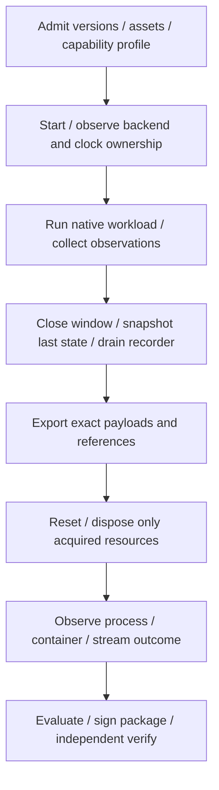

# Execution and deployment design

The [shared target architecture](https://github.com/mmkolpakov/robotics-runtime/blob/main/docs/architecture.md)
defines the platform boundaries. This document specifies worker environments,
native integration and deployment ownership. Available commands and profile
coverage are recorded in the [qualification reference](qualification-baseline.md)
and [compatibility reference](compatibility.md).

## Execution and native APIs

The existing local provider combines a Cordis plugin with a bounded native
worker, environment and qualification profile. The external consumer uses the
finite attempt and evidence boundaries; it does not need Cordis types.
Compose/Execa owns local worker execution. Engine metadata is
read from the same actual endpoint; missing required facts are not filled from
Compose declarations.

Gazebo, Webots and Isaac remain separate native paths:

- ROS Gazebo uses Jazzy/Harmonic and upstream `simulation_interfaces`.
  ROS-free PX4/Gazebo uses native Gz Transport/WorldControl and MAVSDK.
- Webots uses `webots-controller`, a finite `Robot/Supervisor` controller and
  native camera capture. No common ROS dependency or unverified PX4 bridge is
  introduced.
- Isaac uses its official runtime, native application/physics/rendering APIs
  and RTSP writer. The provider retains GPU/runtime/asset identities and
  separate license requirements.

Control and media clients consume the selected native SDK or endpoint directly.
The host does not carry frame payloads, replace the autopilot or translate scenes.
SDF, WBT/PROTO and USD fixtures are checked separately.

## Readiness and capability scope

A loaded plugin, a healthy process, a discovered service and a completed operation
are different facts. Backend startup must establish its native world/device,
required observations and time ownership. A published `GetSimulatorFeatures`
response does not prove that one request advances one physics tick.

Capabilities are accepted for an exact version and environment. A native camera
buffer is not an RTSP endpoint. General simulator integration is not drone
dynamics or autopilot qualification.

Retained ROS v1 requirements such as Clock/JointState/TF remain in their own
profile. Non-ROS providers use native observations and the generic document/
evaluation boundary; they do not generate a fictitious ROS graph.

## Resource and evidence lifecycle

Export precedes destructive reset or disposal. Plugin disposal does not reverse
commands or erase retained evidence. Cleanup errors and incomplete runtime facts
cannot produce a successful qualification; diagnostics remain available.

Inputs are read-only and distinct from writable results. Host and workers have
observed UID/group mappings. Docker and rootless Podman use deployment settings
appropriate to their actual Engine/socket; they do not require changing host
network or remote-access settings.

## Environments and releases

The common host and portable workers are checked on Docker CI and the declared
rootless Podman profile. Isaac's initial renderer/media profile requires a
supported native NVIDIA environment; CUDA discovery alone is not renderer
qualification. Offscreen frames and their visual review are separate from
physics-only success. A stream does not qualify a desktop GUI.

Own provider/bootstrap code and fixtures can be released independently of a
vendor runtime. NVIDIA runtime/assets are consumed through their official
distribution and are not silently republished in this repository's registry.

Source and released runs are independent gates. An immutable Python pair, host
asset and infra lock retain separate source identities; release qualification
installs the published artifacts without rebuilding them from source.

The [qualification reference](qualification-baseline.md) identifies each retained
release, workload, environment and independently consumed result. Source and
release outcomes keep their original identities and scopes.

## Workflow deployment

Dagu is the selected local campaign workbench. Its stock UI, history, scheduling
and MCP interface invoke reviewed finite commands through literal argv execution.
The CLI remains usable without the workbench. The operator selects a Community
or team access profile appropriate to the deployment.

Argo Workflows is the selected Kubernetes campaign system. Standard workflow
and resource templates launch the admitted finite workload and own general DAG
scheduling, fan-out, workflow status and permitted retries. The platform does
not maintain a second general Kubernetes watcher or scheduler. A narrow
execution adapter binds the admitted request to actual Job/Pod/PVC UIDs and
retained evidence. A campaign selects one deployment profile; Dagu and Argo
are not successive owners of one attempt.

Terraform owns AWS networking, capacity, IAM, ECR, CSI and storage foundations.
Helm owns product identity, retained per-run storage and workload packaging.
Product Ansible roles configure explicitly enrolled VM and edge nodes.
Workstation administration is outside product deployment.

One attempt owner coordinates native readiness, measurement, capture, recorder
drain, export and observed cleanup. Retained storage has a lifetime independent
of Workflow garbage collection. Ordinary retries can reassess immutable inputs;
a lost or ambiguous native effect does not authorize measurement replay.
Stop requests and exit handlers do not prove producer quiescence. Recovery
verifies the previous writer stopped and operates only on retained data and
owned resource identities.

Reuse a selected tool through supported configuration, then compose its stock
CLI or native client. A small domain adapter supplies only remaining semantics.
Prefer an upstream fix or contribution to a parallel general implementation.
A limitation of one specialized action is not a reason to replace the tool when
its stock execution boundary supports the workload.

[Component responsibilities](component-responsibilities.md) records the language
and tool boundaries. [Deployment decision](decisions/0009-product-deployment-boundaries.md)
records this ownership model. The shared
[interaction guide](https://github.com/mmkolpakov/robotics-runtime/blob/main/docs/agent-integration.md)
defines CLI, CI and MCP access; the
[canonical diagrams](https://github.com/mmkolpakov/robotics-runtime/tree/main/docs/architecture)
describe the same target.
